# Diagramas UML auxiliares

O enunciado pede os modelos no Astah (`.asta`) e em PDF. **O arquivo Astah não foi alterado
por esta implementação**: a ferramenta de IA não edita `.asta`. Os diagramas abaixo estão em
Mermaid (o GitHub os desenha) e servem de guia para a equipe redesenhar no Astah.

## Pendências no Astah (trabalho da equipe)

1. Criar um diagrama de classes para cada padrão (diagramas 1 a 11 abaixo).
2. Na máquina de estados de Livro, conferir a guarda da renovação: o código usa
   `numRenovacoes < 2` (enunciado da implementação e seção 12 do Trabalho 02). A tabela da
   seção 11 do Trabalho 02 cita `<= 2` como exemplo; com a contagem começando em zero,
   `<= 2` permitiria três renovações.
3. Acrescentar a transição `REPARANDO --registrarLaudoIrrecuperavel--> INCINERADO`.
4. Atualizar os diagramas de sequência de empréstimo e devolução para passar pela
   `CirculacaoFacade` (sequências abaixo).
5. Conferir os nomes. Pela leitura do texto do `.asta` do Trabalho 02, o modelo usa
   `AcervoDeLivros`, `GrupoDePessoas`, `GrupoDeAcademicos` e `GrupoDeColaboradores`; o
   enunciado da implementação manda preservar `Acervo`, `Relacionamento` e `Movimentacao`,
   que são os nomes usados no código. Os diagramas do Astah não foram abertos visualmente.
6. Exportar tudo em PDF.

## Máquina de estados de Livro

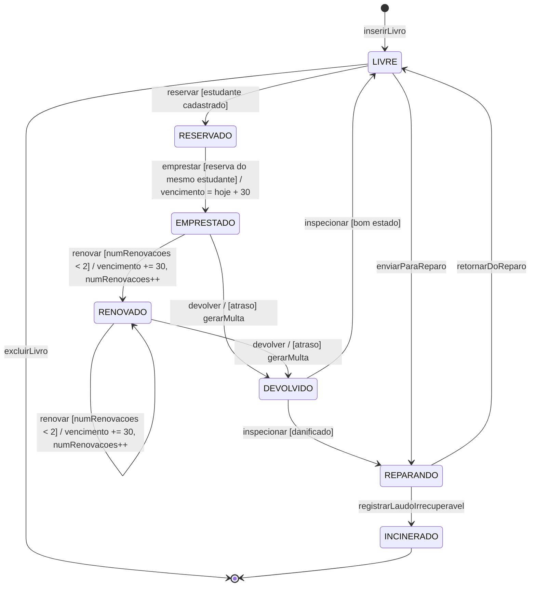

## 1. State

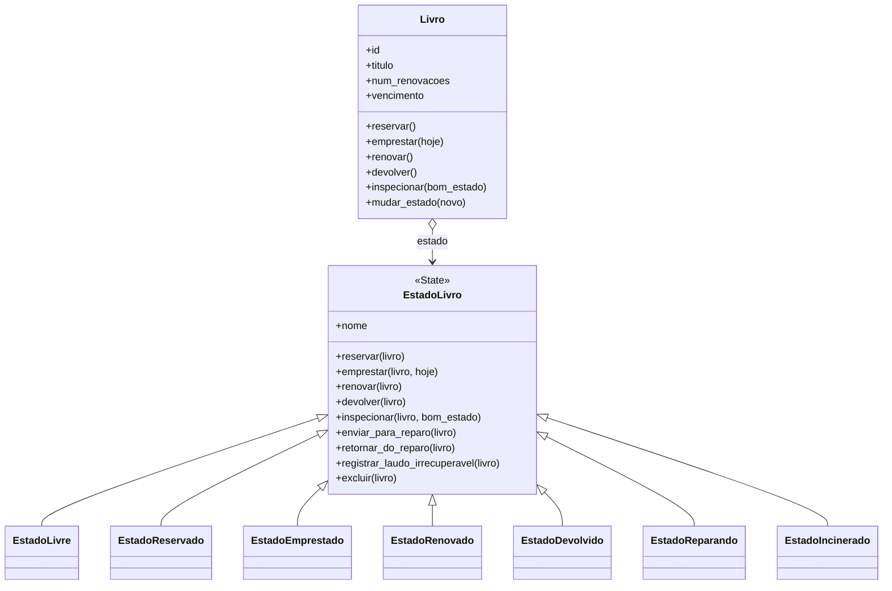

## 2. Strategy

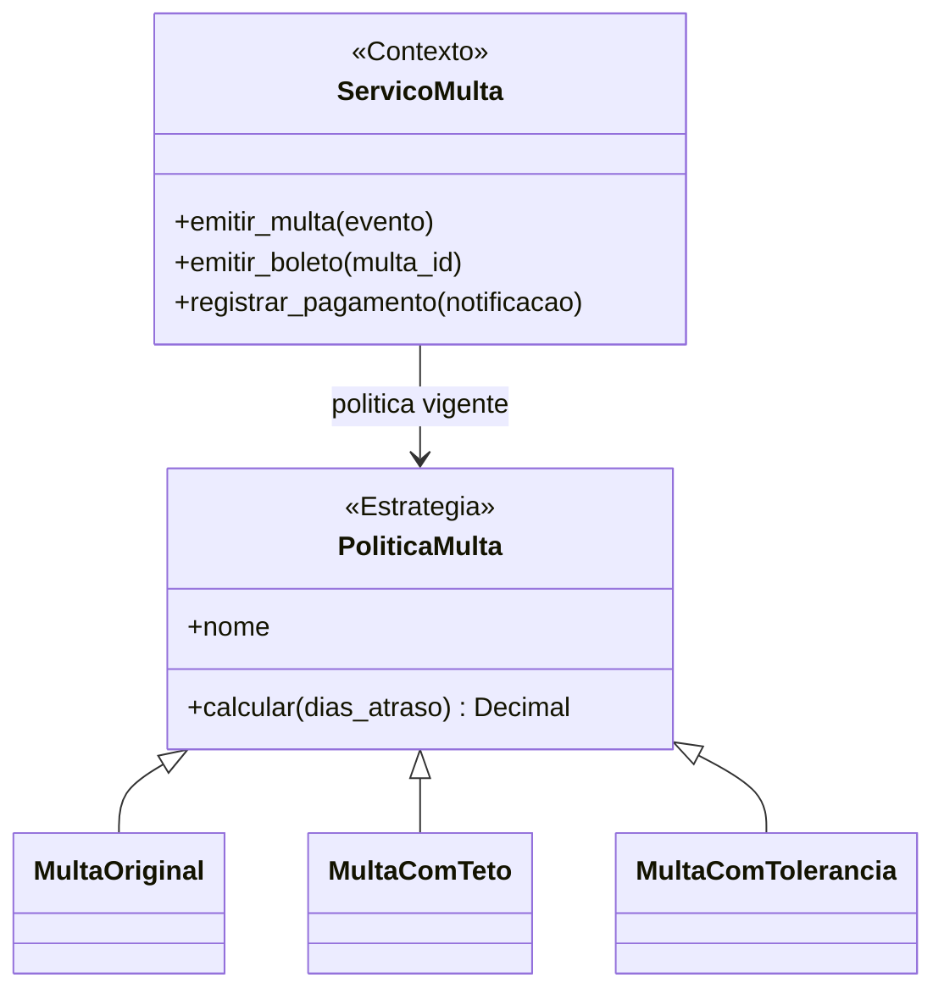

## 3. Adapter

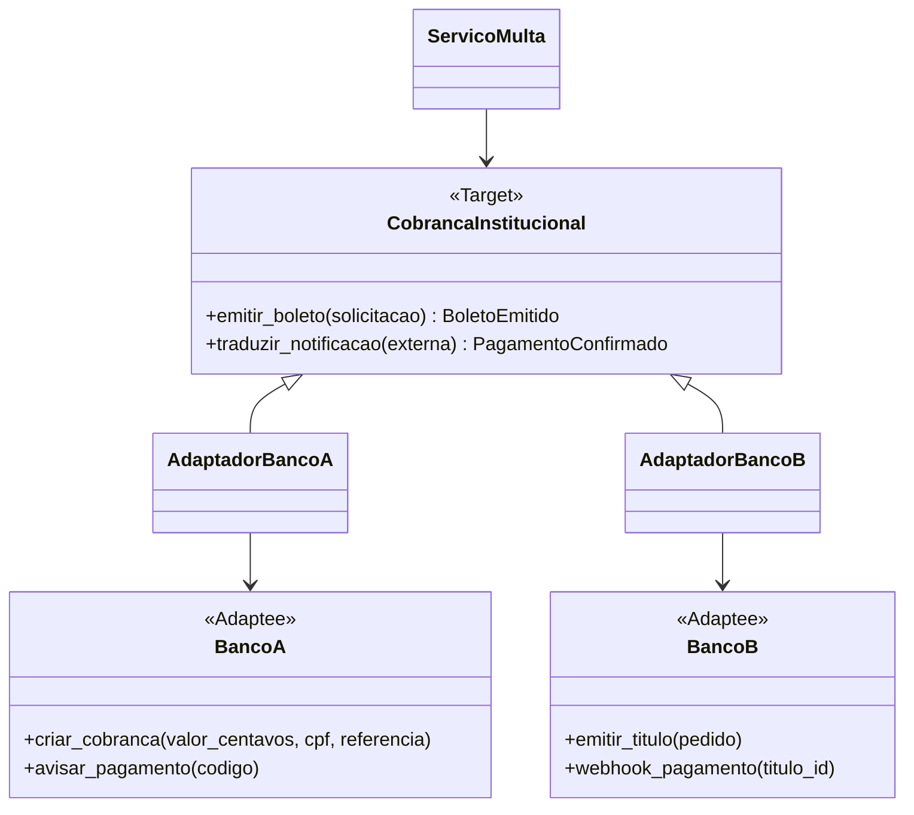

## 4. Facade

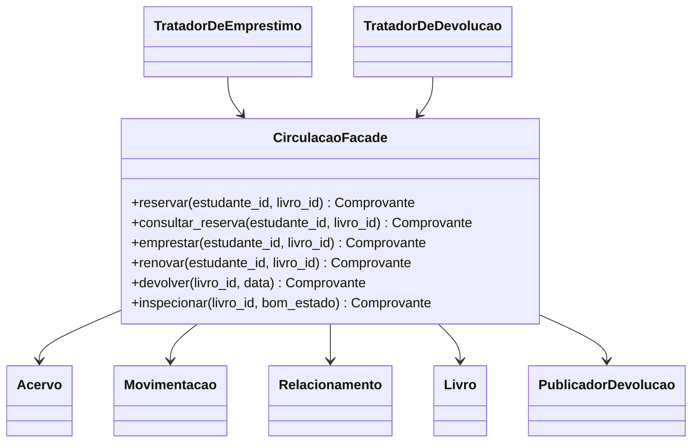

## 5. Observer

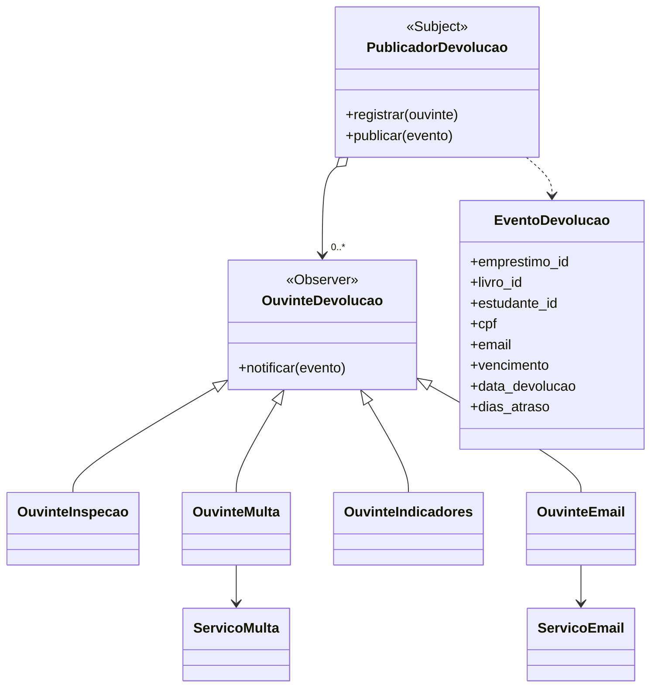

## 6. Command

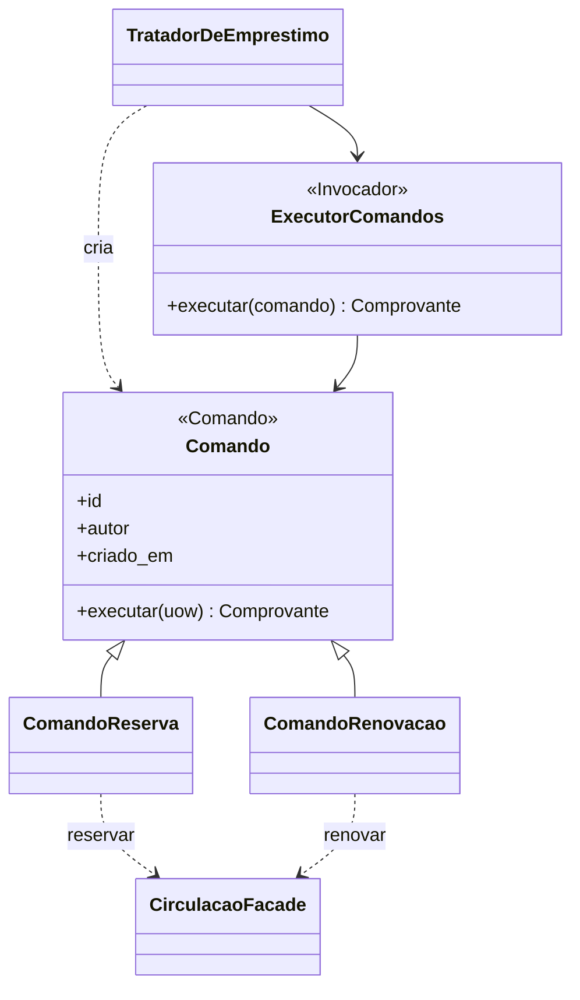

## 7. Template Method

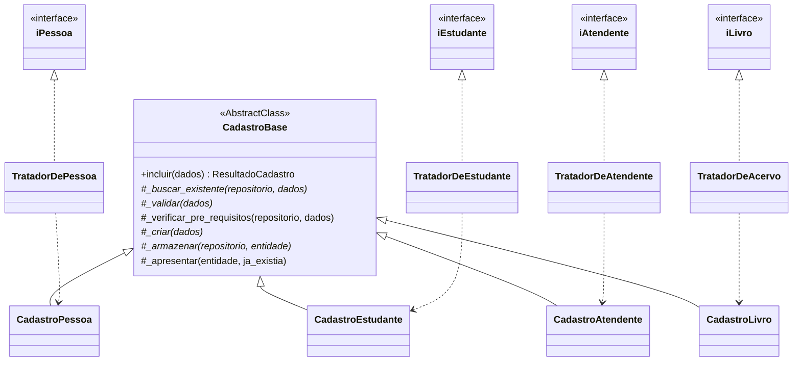

## 8. Abstract Factory

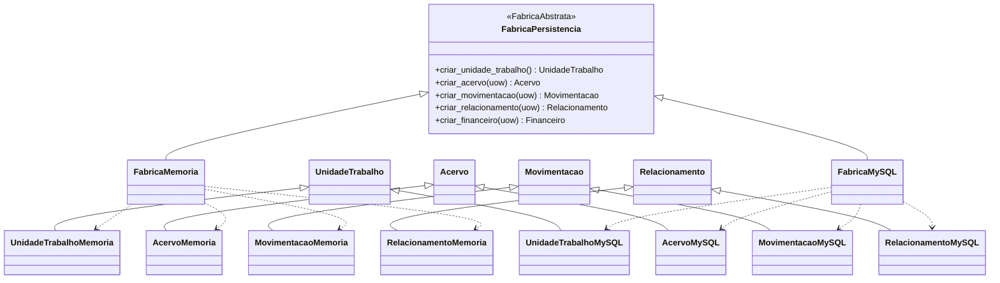

`Financeiro`, `FinanceiroMemoria` e `FinanceiroMySQL` seguem o mesmo desenho.

## 9. Decorator

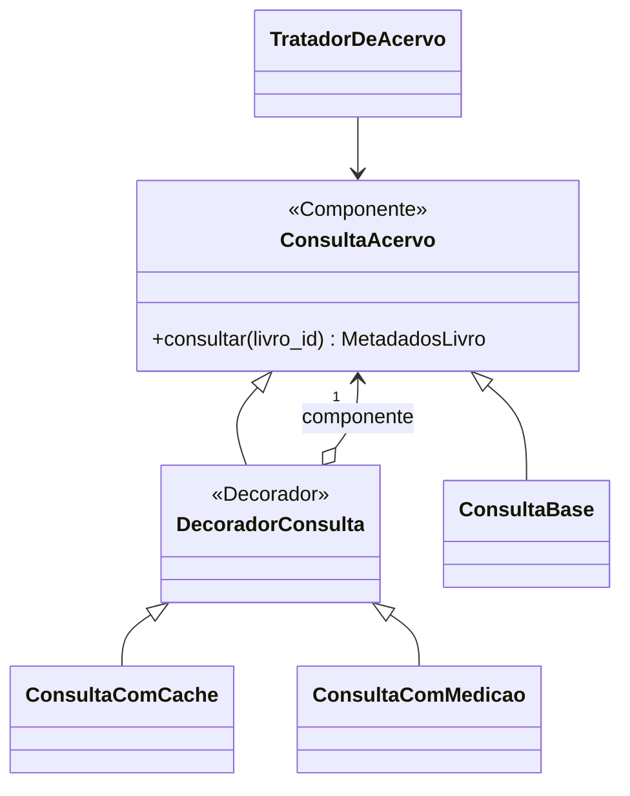

## 10. Composite

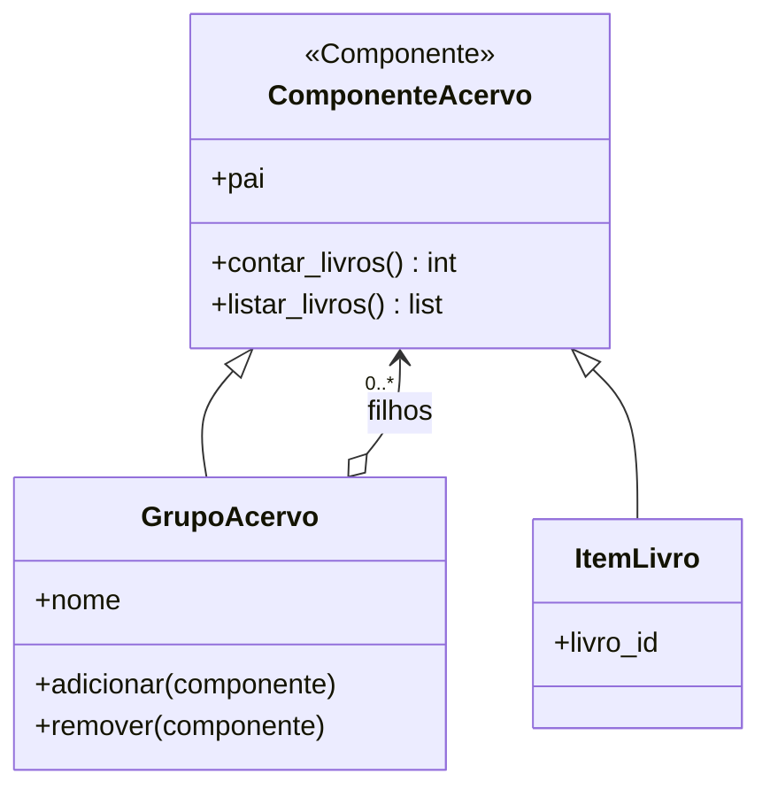

## 11. Singleton

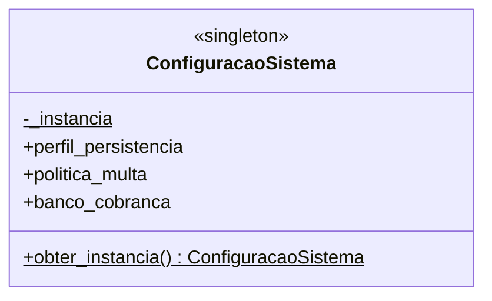

## Sequência: efetivar empréstimo (R04)

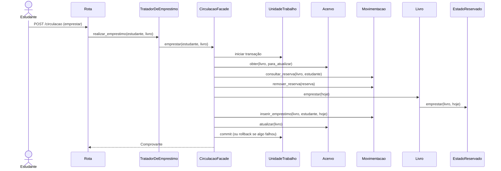

## Sequência: devolução atrasada (R05, R02, R03)

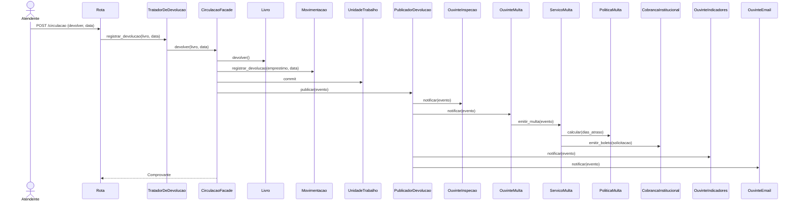

## Sequência: renovação com Command (R06)

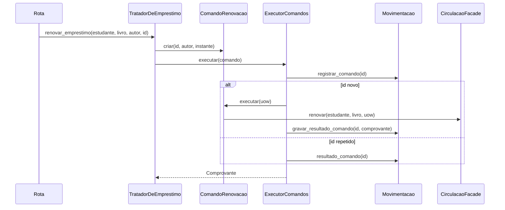
